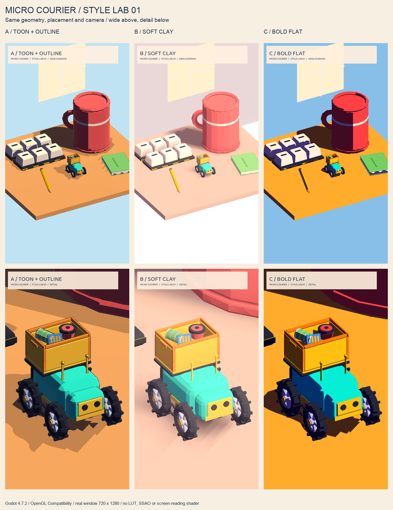

# F7.1 — Micro Courier Stil Laboratuvarı

## Karar özeti

**Önerim: A — Toon + Outline.** Turkuaz robot / sarı sepet kimliğini en iyi koruyan, C kadar yüzey bilgisini kaybetmeyen ve B kadar soluk görünmeyen orta yol. Kullanıcının özellikle reddettiği düşük doygunluk ve sığ ışık yerine belirgin üç ton, sıcak ışık ve koyu silüet veriyor. **Son seçim kullanıcıya ait; bu teslim oyun stilini değiştirmez.** Mobilde hull maliyeti nedeniyle tüm nesnelere körlemesine yaymak yerine robot ve önemli etkileşim nesnelerine sınırlamak önerilir.



## Eşit karşılaştırma sözleşmesi

- `scenes/styles/_key_frame.tscn` ortak iskelet; `style_a.tscn`, `style_b.tscn`, `style_c.tscn` yalnız stil indeksini değiştirir.
- Yerleşim `scripts/styles/style_lab.gd` içindeki isimli, statik tipli sanat sabitlerinden kurulur. İki kadrajın kamera konumu, hedefi ve ortografik ölçeği **A/B/C arasında aynıdır**. Stil seçimi geometriyi oynatmaz.
- Aynı 14 GLB örneği: gövde, dört tekerlek, sepet, üç kargo, iki klavye sırası, dev kupa, kitap ve kalem. Masa yüzeyi/kalınlığı, duvar ve basit pencere ipucu ortak geometridir.
- Mevcut GLB'ler, model kaynakları ve oyun sahneleri değiştirilmedi. Yeni model/ücretli varlık/API üretimi yok; hazır model seti yeniden kullanıldı.
- Kargolar karşılaştırmada okunabilsin diye üçü birlikte, 1.7× vitrin ölçeğinde ve sepetin üstünde görünür konumda gösterilir; bu **oynanış ölçeği veya fizik kararı değildir**. Kitap/kalem masa kompozisyonuna sığacak vitrin ölçeğindedir.
- Tek sıcak DirectionalLight3D, gerçek gölgeler. Oda ipucu gölge üretmez; aksi halde duvar tüm vitrini karartıyordu. Arka plan unshaded; LUT/renk düzeltme, SSR, SSAO, ekran okuyan shader yok.
- Ortam renkleri/enerjileri de stil başına tanımlıdır; yüzey shader'ları ambient'i bilinçli kapatır, renkli emission tabanı ile gölgeleri korur. Bu nedenle görünüm yüksek ambient veya ikinci bir ışığa bağımlı değildir.
- Kamera/sahne fizik içermez; rigid body, collision veya autoload değiştirmez. Ana oyun akışına bağlanmadı.

## A — Toon + Outline

**Görünüm:** Başlangıç paletinin doygun turkuazı, sarı/turuncu vurguları; sıcak ana ışık, üç aydınlanma bandı, hafif rim. `toon.gdshader` gerçek ışık ve gölge zayıflatmasını bantlar. `outline.gdshader` cull_front ters kabuk olarak `next_pass` ile uygulanır. Anahat kalınlığı mesh yerel uzayındadır.

**Artı:** Silüet ve kargo ayrımı güçlü; küçük ekranda renk kimliği korunuyor; form C'den daha iyi tarif ediliyor. Dokulara/postprocess'e ihtiyaç duymuyor.

**Eksi:** Hull ikinci geometri çizimi ister. V1 modellerin düz/ayrık normalleri yakın planda özellikle sepet köşeleri ve lastiklerde ince kırık çizgiler üretebiliyor; gerçek oyuna yaymadan önce outline-normal iş akışı seçilmeli. Çoklu ışık bantları yıkayabilir; laboratuvar tek ışıklıdır.

**Mobil tahmin:** Doku örneği yok; fragment'ta bir rim `pow`, light'ta iki `step`/`mix`. 42 GLB yüzeyi + 5 ortak kutu = yaklaşık **47 ana yüzey gönderimi**; outline GLB yüzeylerine ve masaya 43 ek geçiş getirir: yaklaşık **90 ana pass gönderimi** (culling/batching öncesi, gölge ve UI hariç). Gerçek draw call/FPS ölçümü değildir.

**Tüm oyuna uygulama:** Orta. Renk rolü → shader malzemesi eşlemesi ve önemli nesnelerde hull; kamera ölçeğine göre outline ayarı/normal temizliği gerekir. Bu görev bunları mevcut oyuna uygulamaz.

## B — Soft Clay

**Görünüm:** Aynı paletin sıcak pastel yorumu; mat kil, sarılı/yumuşak diffuse, nesne-yerel Y gradyanı; outline yok. Yumuşak filtreli gerçek gölgeler + robot/kupa/iki klavye altında dört UV radyal blob. Bloom açıktır ama düşük şiddettedir (`0.06`, eşik `1.1`); temel hacim bloom kapalıyken de korunur.

**Artı:** Sıcak, oyuncak/diorama hissi; sert siyah gölge yok. Yakın planda bevel yüzeyleri en rahat bu varyantta okunuyor. Hull'a ihtiyaç yok.

**Eksi:** V1 flat normalleri yüzünden kusursuz pürüzsüz kil değil, fasetli kil. Parlak tuşlar ve açık masa birbirine A/C'ye göre daha yakın; kullanıcı doygunluğu öncelerse zayıf aday. Geniş kare altındaki beyaz boşluk stilin açık arka planı; ana nesnelerde yanık beyaz bölge bırakılmadı.

**Mobil tahmin:** Doku yok; `smoothstep`, `clamp`, basit arithmetic; dört ucuz transparan plane eklenir. Yaklaşık **51 ana yüzey gönderimi**, UI/gölge/bloom hariç. Blob'larda overdraw ve bloom'un render-target/bant genişliği maliyeti var. En düşük cihazda önce bloom kapatılabilir; görünüm ona bağlı değildir. Gerçek cihaz profili alınmadı.

**Tüm oyuna uygulama:** Düşük–orta. Malzemeler ve aydınlatma kolay aktarılır; hareket eden robotun blob'u ve her zemin/nesne için temas gölgesi boyutu düzenlenmeli. Yumuşak gölge kalitesi gerçek cihazda denenmeli.

## C — Bold Flat

**Görünüm:** En yüksek doygunluk, turkuaz/sarı büyük bloklar, mor/lacivert sert gölgeler. `flat.gdshader` türevlerden yüz normali alır; tek eşikle iki güçlü değer bölgesi verir. Outline yok; koyu görünen kenarlar gerçek model/geometri ve gölge yüzleridir. Ek çizgi/doku detayı üretilmez; V1 geometri detayları korunur.

**Artı:** En sert görsel ayrım, reklam/telefon boyutunda güçlü ikonlaşma; tek yüzey pass'i. Çok az shading detayı ile okunur.

**Eksi:** Robotun gölge tarafı ve lastikler bazı açılarda birbirine yaklaşır; gövde fasetleri A/B'ye göre kaybolur. Turuncu masa oldukça baskın; tam oyunda tehlike sarısı ile semantik ayrım ayrıca kontrol edilmeli.

**Mobil tahmin:** Doku yok; `dFdx/dFdy`, cross/normalize ve tek `step`. Yaklaşık **47 ana yüzey gönderimi**, gölge/UI hariç. Bloom, outline ve transparan blob maliyeti yok. Sayı yalnız bu kompozisyon için yapısal tahmindir; türevlerin gerçek GPU maliyeti cihazdan cihaza değişir.

**Tüm oyuna uygulama:** Düşük–orta. Malzeme eşlemesi kolay; sert gölge sınırlarının oynanış kameralarında nesne okunurluğunu bozmaması için sahne bazında ışık/palet kontrolü gerekir.

### Ortak maliyet notu

Yukarıdaki sayılar renderer profiler ölçümü değil, materyal-yüzey sayısından çıkarılan culling/batching öncesi karşılaştırma tahminidir. DirectionalLight3D'nin varsayılan dört split gölgesi ek gölge gönderimleri doğurabilir; bu sayılara katılmadı. Tüm oyuna entegrasyonda mobil gölge mesafesi/split sayısı için ayrıca gerçek cihaz bütçesi belirlenmeli. Bu teslimde mobil FPS/termal test yapılmadı.

## Görüntüler

Altı kaynak görüntü **720×1280 (9:16)** gerçek Godot pencere çıktısıdır. Proje hedefi 1080×1920 olarak kalır; bu boyutta pencere OS ekran sınırına sığmadığı için ilk denemeler farklı yüksekliklere sıkıştırılıyordu. Bu nedenle karşılaştırmayı bozmayan, ekrana sığan ortak 9:16 boyut kullanıldı; `project.godot` değiştirilmedi. Kaynak PNG'lere renk düzeltme/kırpma uygulanmadı. Kontak sayfasında yalnız eşit küçültme yapıldı (1368×1776).

| Stil | Geniş | Yakın |
|---|---|---|
| A | [style_a_wide.png](style_a_wide.png) | [style_a_close.png](style_a_close.png) |
| B | [style_b_wide.png](style_b_wide.png) | [style_b_close.png](style_b_close.png) |
| C | [style_c_wide.png](style_c_wide.png) | [style_c_close.png](style_c_close.png) |

[Kontak sayfası](style_lab_sheet.png)

### Tekrar üretme

Proje kökünden, masaüstü/pencere oturumu açıkken:

```bash
bash docs/art/capture_style_lab.sh
```

Betik mevcut `tools/scene_shot.gd` aracını kullanır (değiştirilmedi); örnek tek çekim:

```bash
godot --path . --resolution 720x1280 \
  --log-file "$PWD/docs/art/style_a_close.log" \
  -s res://tools/scene_shot.gd -- \
  --scene=res://scenes/styles/style_a.tscn \
  --out=res://docs/art/style_a_close.png --frames=48 --frame=close
```

`--frame=close` çıkarılırsa geniş kare. `--style=a|b|c` ortak `_key_frame.tscn` üzerinde de seçilebilir. Başka özel test argümanı gerekmez. Betik sonunda `python3 docs/art/build_style_lab_sheet.py` çağrılır; **`-I` kullanılmaz**. Pillow var olan ortamdan kullanılır; bağımlılık kurulmadı. Sayfa üreticisi bu macOS ortamının Arial fontunu kullanır; başka işletim sisteminde `FONT_PATH` uyarlanmalıdır.

## Görsel inceleme ve doğrulama

Altı kare kontak sayfasında, A/B/C yakınları ayrıca görüntü okuyucu ile incelendi. İlk turdaki duvar gölgesi kaldırıldı; geniş/yakın ölçekleri tüm robot silüeti için açıldı; koyu arka planda okunmayan başlıklara ortak açık bilgi paneli eklendi. B'nin fazla soluk ilk sürümünde pastel karışımı ve bloom azaltılıp yeniden çekildi. Son görüntülerde turkuaz robot/sarı sepet okunur; B bilinçli pastel, C bilinçli sert kontrastlıdır. A hull normal dikişleri üretim kalitesi riski olarak saklanmadı.

Yeni görsel kurulum davranışı için kapsam içinde eklenen probe:

```bash
godot --headless --path . \
  --log-file "$PWD/docs/art/style_lab_probe_engine.log" \
  -s res://scripts/styles/style_lab_probe.gd
```

Probe altı kombinasyonda 14 model, dört tekerlek, üç kargo, tüm modellerin eşit global transformları, sabit kamera ölçeği, tüm GLB yüzeylerinin stil malzemesi alması ve yalnız A'da outline bulunduğunu kontrol eder. Genel `tests/run_tests.gd` içine eklenmez; core/oynanış davranışı değişmedi. Probe ayrıca manuel çalıştırıldı ve geçti. Gerçek GL Compatibility shader derlemesi altı pencere çekimiyle kontrol edildi.

Zorunlu komut gerçekten çalıştırıldı:

```bash
bash /Users/alperaygorduler/Desktop/Games/studio-kit/tools/verify.sh .
```

Sonuç: **PASS** — import tamam, açılış sahnesi yüklendi, **162 test / 745 doğrulama; 0 başarısız, 0 dosya hatası; `SONUC: gecti`**. Tam komut çıktısı: [style_lab_verify.log](style_lab_verify.log). Pencere çekim çıktısı: [style_lab_capture.log](style_lab_capture.log). Probe çıktısı: [style_lab_probe.log](style_lab_probe.log).

## Düzeltme turu 1 — kabul hatasının ayrıştırılması

**Genel kabul hâlâ başarısız; reklam hatası bu kapsam içinde çözülemedi.** Önceki bölümdeki `verify.sh PASS` ifadesi yalnız import/açılış/birim testleri içindir; tüm bağımsız kabul probelerinin geçtiği anlamına gelmez.

Bu tur mevcut stil kodu, shader'lar, sahneler ve ekran görüntüleri korunmuştur. Model sayfası ve altı karenin kontak sayfası yeniden incelendi; yeni görsel üretim veya oynanış değişikliği yapılmadı. A önerisi ve outline-normal dikişi riski geçerlidir.

Gerçekten yeniden çalıştırılan kontroller:

| Kontrol | Sonuç | Kanıt |
|---|---|---|
| `bash /Users/alperaygorduler/Desktop/Games/studio-kit/tools/verify.sh .` | Çıkış **0**; 162 test, 745 doğrulama; 0 başarısız, 0 dosya hatası; `SONUC: gecti` | [style_lab_retry_verify.log](style_lab_retry_verify.log) |
| `godot --headless --path . -s res://scripts/styles/style_lab_probe.gd` | Çıkış **0**; altı kombinasyonda kamera/transform/model/malzeme eşitliği geçti | [style_lab_retry_probe.log](style_lab_retry_probe.log) |
| `godot --headless --path . -s res://tools/ads_probe.gd` | Çıkış **2**; aynı `instant/force_result` kurulum hatası yeniden üretildi | [style_lab_retry_ads.log](style_lab_retry_ads.log) |

### Kök neden ve lidere gerekli işlem

- `tools/ads_probe.gd:64–67`, `AdManager.provider` üzerinde `instant` ve `force_result` alanlarını arar. Mevcut `scripts/services/mock_ads_provider.gd` bu alanları tanımlamaz; yalnız gecikmeli/rastgele sonuç üretir. `scripts/autoload/AdManager.gd:38` bu sağlayıcıyı kurar.
- `ARCHITECTURE.md §5.5` bu iki alanı açıkça gerektirir. Ayrıca mevcut `AdManager.Placement` hâlâ `EXTRA_POCKET`/`TAPE_RESCUE` şablon yerleşimlerini içerir; sözleşme `CARGO_INSURANCE`/`BATTERY_RECHARGE`/`TRY_BEFORE_BUY`/`GOLDEN_BOX` bekler. Bu nedenle yalnız iki alanı eklemek de tüm reklam kabulünün geçeceğini kanıtlamaz.
- `git diff --exit-code HEAD -- scripts/autoload/AdManager.gd scripts/services/mock_ads_provider.gd tools/ads_probe.gd` çıkış **0** verdi: ilgili üç dosyada HEAD'e göre değişiklik yoktur. Reklam probu stil sahnesi yüklenmeden kurulumda durur.
- Bu dosyalar izin verilen `scenes/styles/`, `assets/shaders/`, `docs/art/`, `scripts/styles/` kapsamı dışındadır. Stil script'inden autoload/provider yamalama, sınıf gölgeleme veya probu atlatma yapılmadı. **Liderin Faz 5 reklam uygulaması ile §5.5 kabul sözleşmesini ayrı kapsamda uzlaştırması gerekir.**
- Kabul çıktısındaki `Parse JSON failed ... Expected key`, reklam kurulum hatasından ayrıdır. Yeniden doğrulamanın `build/verify/tests.log:116–130` geri izi `tests/unit/test_save_service.gd:146` → `SaveService.gd:57` gösterir. `test_corrupt_file_is_backed_up_and_recovers` kasıtlı `{bu json degil` içeriğini okutur ve geçer. Logdaki hata satırı saklanmadı; bu tur veri veya kayıt kodu değiştirilmedi. `VERIFY_STRICT=1` ile doğrulama çalıştırılmadı.

Bu tur diğer gameplay/flow/level/meta probeleri veya gerçek pencere çekimleri yeniden çalıştırılmadı; onlar için yeni bir geçiş iddiası yoktur. Godot'un otomatik ürettiği kapsam dışı UID dosyalarına elle müdahale edilmedi.

## Düzeltme turu 2/2 — kapsam engelleri ve son doğrulama

**Durum: partial; genel kabul hataları çözülmedi.** Bu tur sahne/shader/oynanış koduna veya mevcut PNG'lere müdahale edilmedi. Model sayfası ve kontak sayfası tekrar görüntü okuyucuyla incelendi; A önerisi ve hull-normal dikişi riski değişmedi. Yeni pencere çekimi ya da mobil performans testi yapılmadı.

| Yeniden çalıştırılan komut | Gerçek sonuç | Tam çıktı |
|---|---|---|
| `bash /Users/alperaygorduler/Desktop/Games/studio-kit/tools/verify.sh .` | Çıkış **0**, import/açılış geçti; **162 test, 745 doğrulama, 0 başarısız, 0 dosya hatası; SONUC: gecti** | [style_lab_round2_verify.log](style_lab_round2_verify.log) |
| `godot --headless --path . --log-file "$PWD/docs/art/style_lab_round2_probe_engine.log" -s res://scripts/styles/style_lab_probe.gd` | Çıkış **0**; altı kombinasyon, aynı transform/kamera, 14 model, dört tekerlek, üç kargo ve stil malzemeleri geçti | [style_lab_round2_probe.log](style_lab_round2_probe.log) |
| `godot --headless --path . --log-file "$PWD/docs/art/style_lab_round2_ads_engine.log" -s res://tools/ads_probe.gd` | Çıkış **2**; `instant/force_result` kurulum hatası sürüyor | [style_lab_round2_ads.log](style_lab_round2_ads.log) |

Lider için iki ayrı engel:

1. **Reklam sözleşmesi kapsam dışında:** `scripts/services/mock_ads_provider.gd` hâlâ `instant`/`force_result` tanımlamıyor. `git diff --exit-code HEAD -- scripts/autoload/AdManager.gd scripts/services/mock_ads_provider.gd tools/ads_probe.gd` yeniden **0** döndü; hata veren üç dosya HEAD ile aynı. Stil script'lerinde reklam sağlayıcısına başvuru bulunmuyor. Bu görevin izinli dört dizini içinde reklam kabulünü dürüstçe düzeltecek bir değişiklik yok; lider ayrı kapsamda Faz 5 sözleşmesini uzlaştırmalı. Probe atlatılmadı, korumalı dosyalar değiştirilmedi.
2. **Kapsam dışı UID dosyaları tur başlangıcında zaten vardı:** `git status --short` ilk kontrolde ve son kontrolde `?? tools/ads_probe.gd.uid` ile `?? tools/polish_probe.gd.uid` gösterdi. KAPSAM yalnız `scenes/styles/`, `assets/shaders/`, `docs/art/`, `scripts/styles/` yollarına yazmaya izin verdiği için bu iki dosya **silinmedi/değiştirilmedi**. Bu nedenle kapsam hatası giderildi denmiyor. Liderin bu üretilmiş metaverileri kendi yetkili temizleme/entegrasyon adımında ele alması gerekiyor; sonraki Godot importu UID'leri yeniden üretebilir.

Kabulün alıntıladığı JSON hatası yeniden `build/verify/tests.log:116–130` içinde görüldü: geri iz `test_corrupt_file_is_backed_up_and_recovers` → `SaveService.load_profile` gösteriyor ve aynı test **PASS**. Bu kasıtlı bozuk kayıt testinin çıktısı gizlenmedi; reklam kurulum hatasının nedeni değil. `VERIFY_STRICT=1` çalıştırılmadı. Diğer bağımsız gameplay/flow/level/meta probeleri bu tur tekrar çalıştırılmadı.

Bu turun elle düzenlenen tek dosyası bu belgedir; yeni kanıt çıktıları `docs/art/style_lab_round2_*.log` altındadır. Zorunlu verify aracının otomatik `build/verify/` çıktıları dışında elle kapsam dışına yazılmadı. `git diff --check` geçti. Genel kabul için **PASS iddiası yoktur**.

## Dosya grupları / entegrasyon sınırı

- `scenes/styles/{_key_frame,style_a,style_b,style_c}.tscn`
- `scripts/styles/{style_lab,style_lab_probe}.gd` (+ Godot UID metaverileri)
- `assets/shaders/style_lab/{toon,outline,clay,flat,blob}.gdshader` (+ UID metaverileri)
- `docs/art/style_{a,b,c}_{wide,close}.png`, `style_lab_sheet.png` (+ Godot import metaverileri)
- `docs/art/{STYLE_LAB.md,capture_style_lab.sh,build_style_lab_sheet.py,style_lab_capture.log,style_lab_probe.log,style_lab_verify.log}`

TASKS/CHANGELOG, mevcut Game/Proto/levels, scripts/core, scripts/gameplay, tools probeleri ve proje/export ayarları değişmedi. Kullanıcı seçimi ve gerçek mobil profil çıkarma bir sonraki aşamanın işidir.
