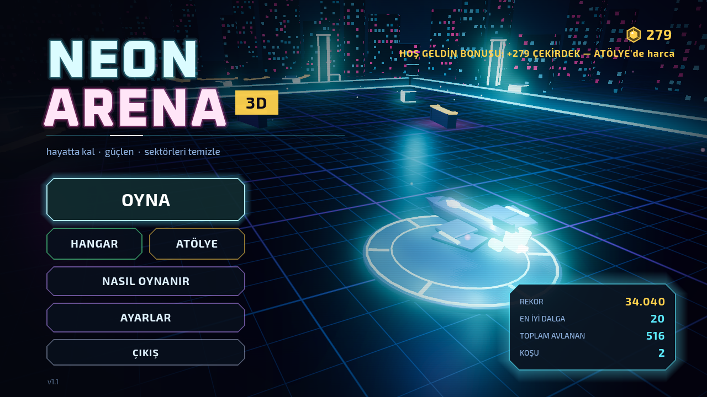
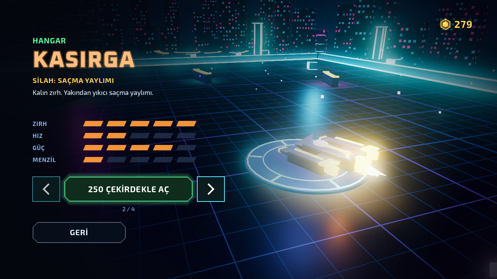
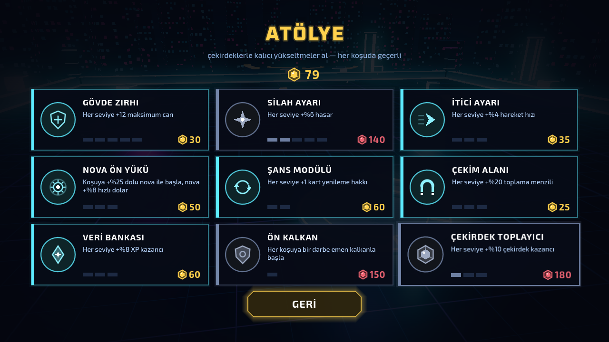
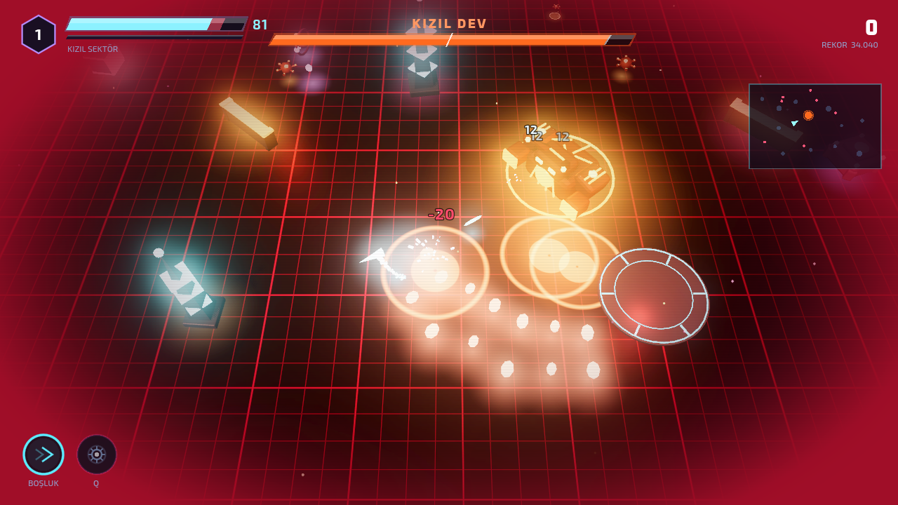
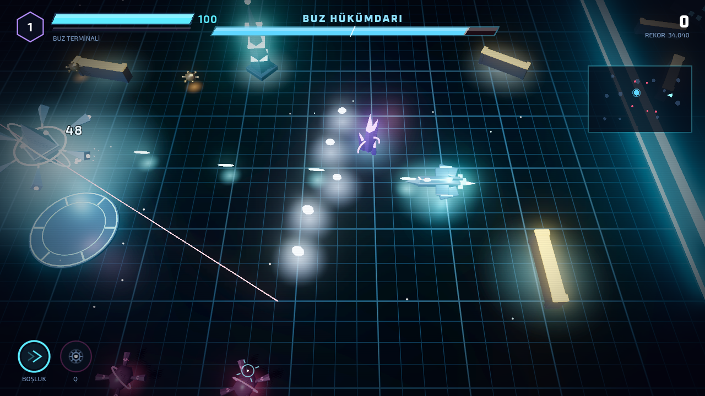
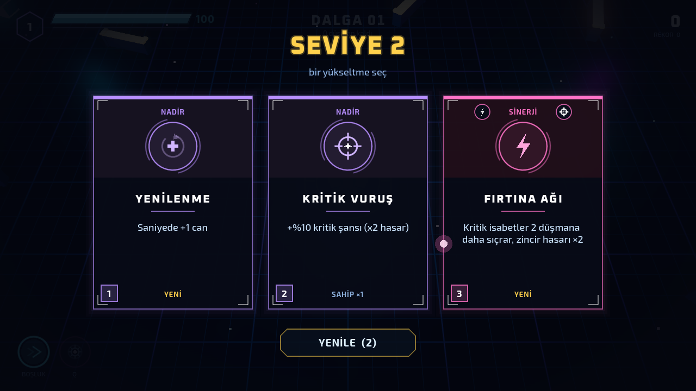
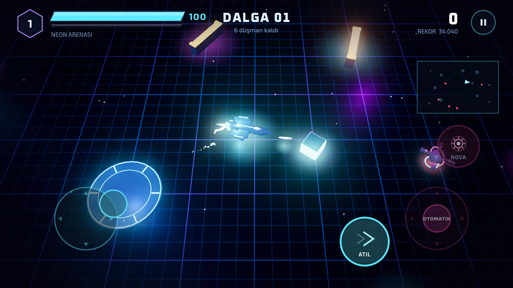
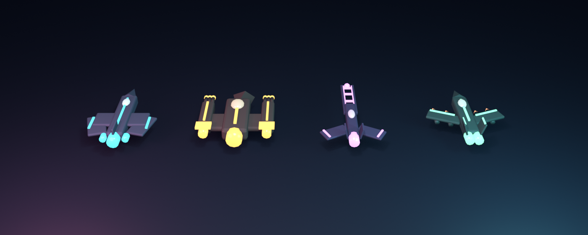
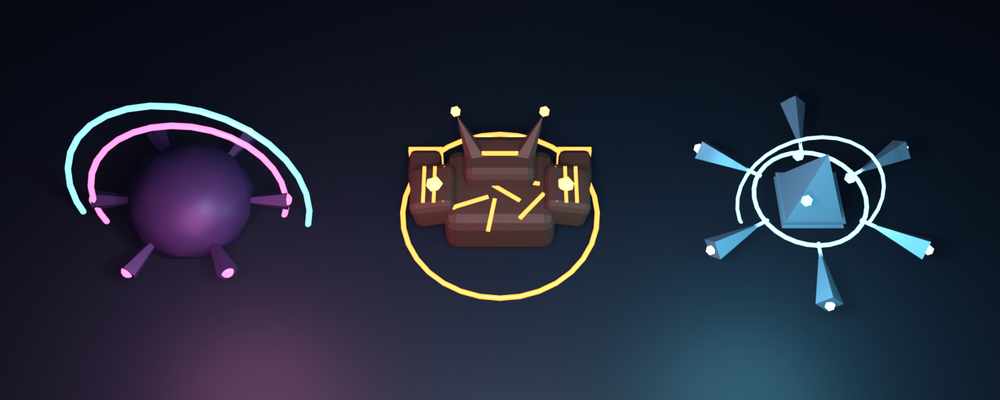

# NEON ARENA 3D



Tepeden görünüm, roguelite ilerlemeli neon arena hayatta kalma oyunu. Masaüstü (fare/klavye) ve
**Android** (dokunmatik) için. **Godot 4.7.2** (Mobile renderer) + **Blender 5.2** ile üretilmiş 20 `glb` model.
Türkçe ve İngilizce.

| Hangar: 4 gemi | Atölye: kalıcı yükseltmeler |
|---|---|
|  |  |

| KIZIL DEV: yer uyarıları, şok dalgası | BUZ HÜKÜMDARI: lazer ışınları, ışınlanma |
|---|---|
|  |  |

| Sinerji kartı | Dokunmatik kontroller |
|---|---|
|  |  |

## Çalıştırma

Proje klasörünün içinden:

```bash
godot --path .          # doğrudan oyna
godot --path . -e       # editörde aç
```

Finder'dan çift tıklama: `Neon Arena 3D.command`.

### Android

APK repoda tutulmaz (`build/` yok sayılır); aşağıdaki komutla üretilir. Gereken: Godot 4.7.2 Android
dışa aktarma şablonları, Android SDK ve JDK 17 (Godot editör ayarlarında tanımlı). Çıktı hata ayıklama
imzalı, arm64, Android 7+.

```bash
godot --headless --path . --export-debug "Android" build/android/neon-arena-3d-debug.apk   # üret
adb install -r build/android/neon-arena-3d-debug.apk          # USB ile bağlı telefona kur
```

APK'yı telefona kopyalayıp dosya yöneticisinden de kurabilirsin ("bilinmeyen kaynaklar" izni gerekir).
Play Store için kalıcı bir yükleme anahtarıyla `--export-release` gerekir (bkz. Notlar).

## Kontroller

| Masaüstü | Dokunmatik | İşlev |
|---|---|---|
| WASD / yön tuşları | sol çubuk | hareket |
| Fare + sol tık | sağ çubuk | nişan + ateş (dokunmatikte parmak kalkınca otomatik nişan) |
| Boşluk / Shift | ATIL | atılma (kısa dokunulmazlık; hareket yoksa nişan yönüne) |
| Q / sağ tık | NOVA | dolunca çevredeki düşmanları ve mermileri siler |
| 1 / 2 / 3 | karta dokun | seviye kartı seç |
| ESC / P | ⏸ düğmesi / Android geri | duraklat |
| M | — | sessiz |

## Oyun döngüsü

1. **Düşman öldür → kombo → puan + XP.** Kombo çarpanı ×6'ya kadar çıkar; 10/25/50/100 kombo eşikleri nova doldurur.
2. **Seviye atla → 3 karttan birini seç** (20 normal kart + 6 sinerji). Kart yenileme hakkı vardır.
3. **Her 5. dalga boss**, yenince yeni sektör: yeni harita, yeni renkler, yeni boss.
4. **Ölünce ÇEKİRDEK kazanırsın** (puan + dalga + yenilen boss). Çekirdeklerle Atölye'den kalıcı
   yükseltme alır, Hangar'dan yeni gemi açarsın.

## Gemiler (Hangar)

| Gemi | Silah | Özellik | Fiyat |
|---|---|---|---|
| VEKTÖR | atış topu | dengeli, hızlı tek atış | açık |
| KASIRGA | saçma yaylımı | kalın zırh, yakın mesafe 6'lı saçma | 250 |
| MIZRAK | raylı top | hafif gövde, hattaki her şeyi delen ağır atış | 450 |
| ŞAHİN | güdümlü roket | hedefini kendi bulan, çarpınca patlayan roketler | 700 |

"Çoklu Atış" kartı her gemide farklı işler: yaylımda +2 saçma, raylı topta paralel ray, roketlerde ek roket.

## Atölye (kalıcı yükseltmeler)

Gövde zırhı (+can) · Silah ayarı (+hasar) · İtici ayarı (+hız) · Nova ön yükü · Şans modülü (+kart yenileme) ·
Çekim alanı (+mıknatıs) · Veri bankası (+XP) · Ön kalkan · Çekirdek toplayıcı (+çekirdek kazancı).
Veriler: `data/upgrades.json`.

## Sektörler ve bosslar

| Sektör | Boss | Saldırılar |
|---|---|---|
| Neon Arenası | SENTİNEL | radyal dalga, nişanlı üçlü, uyarılı hücum, (öfke) sarmal yaylım |
| Kızıl Sektör | KIZIL DEV | yere uyarı daireleri + patlama, boşluklu şok dalgası, alev yelpazesi, (öfke) sıçrama, bombacı çağırma |
| Buz Terminali | BUZ HÜKÜMDARI | dönen lazer ışınları (önce uyarı çizgisi), buz kristali yelpazesi, ışınlanma, (öfke) 3 ışın + dörtlü sarmal |

Döngü tamamlanınca bosslar "MK-2" olarak daha güçlü döner. Değerler: `data/balance.json` → `boss_kinds`.

## Sinerjiler

İki uyumlu kart alınınca havuza özel bir sinerji kartı girer:

| Sinerji | Gereken | Etki |
|---|---|---|
| FIRTINA AĞI | Zincir Şimşek + Kritik Vuruş | kritikler 2 düşmana daha sıçrar, zincir hasarı ×2 |
| KAN HASADI | Vampir + Yenilenme | taşan iyileşme kalkana dönüşür |
| KIYAMET NOVASI | Nova Çekirdeği + Patlayıcı Mermi | nova %50 geniş + 3 artçı patlama |
| YILDIRIM KOŞUSU | Şok Atılması + Kısa Devre | atılma hasarı ×2, atılırken öldürmek beklemeyi sıfırlar |
| KOVAN ZİHNİ | Refakat Drone + Çoklu Atış | +1 drone (sınır 3), dronlar iki kat hızlı |
| DİKEN KALESİ | Diken Zırh + Zırh Plakası | hasar alınca 12 mermi, diken ×3 |

## Ses

Tüm ses efektleri ve 3 müzik (menü 84 BPM, savaş 128 BPM, boss 140 BPM) `tools/make_audio.py` ile sıfırdan
sentezlenir (numpy). Müzik/Efekt/Arayüz kanalları, sınırlayıcı, parça geçişlerinde çapraz geçiş, duraklatmada
boğuk müzik. `tools/audio_report.py` ses yüksekliği (LUFS), tepe, DC ve döngü dikişi raporu verir; oyun içi
kazançlar bu ölçüme göre dengelenmiştir. Dinlemek için: `docs/audio/ses_vitrini.wav`.

## Dil

Türkçe metinler anahtardır, İngilizceler `data/lang_en.json` ve JSON kayıtlarındaki `*_en` alanlarında.
Ayarlar → DİL / LANGUAGE ile anında değişir. `test_i18n.gd` çevrilmemiş metin bırakılmasını yakalar.

## Blender varlıkları




```bash
blender -b --python tools/blender/make_models.py                          # 20 glb
blender -b --python tools/blender/make_models.py -- ship_hawk,boss_frost  # yalnız seçilenler
blender -b --python tools/blender/render_preview.py -- out.png ship.glb,ship_storm.glb
```

## Klasör yapısı

```
scripts/autoload/   settings (kayıt + kalıcı ilerleme), game_data, i18n, fx, sound
scripts/core/       run_state, loadout (kartlar + sinerjiler), meta_progress (çekirdek/atölye/gemi), arena_space
scripts/entities3d/ player3d (gemi değişimi), enemy3d (7 tür + elit), boss3d (3 tür, 2 faz), pickup3d
scripts/world/      map_builder, sparks (MultiMesh efektler), bullet_field (MultiMesh mermiler), model_cache
scripts/ui/         game3d (döngü), hud, menus (menü/hangar/atölye/ayarlar/kartlar), touch_controls, ui_kit
data/               balance · cards · maps · ships · upgrades · lang_en (.json)
assets/             models (20 glb) · audio (48 wav) · fonts (Oxanium, Exo 2 — OFL) · shaders · icons
tests/unit/         49 test
tools/              verify.sh · smoke_test.gd · screenshot.gd · make_audio.py · audio_report.py · blender/ · dev/
```

## Komutlar

```bash
tools/verify.sh                                                     # içe aktarma + 49 test + açılış
godot --headless --path . -s res://tools/smoke_test.gd -- --demo --ship=sahin --seconds=40
godot --headless --path . -s res://tools/dev/meta_probe.gd -- --no-save      # atölye etkileri + ödül
godot --headless --path . -s res://tools/dev/synergy_probe.gd -- --no-save   # 6 sinerji
godot --headless --path . -s res://tools/dev/touch_probe.gd -- --no-save     # çoklu dokunuş
godot --path . --resolution 1280x720 -s res://tools/screenshot.gd -- --demo --wave=5 --map=1 --times=4
```

Oyun argümanları (`--` sonrası): `--demo` (bot oynar, kayıt tutmaz), `--wave=N`, `--map=N`, `--ship=ID`,
`--boss=sentinel|titan|frost`, `--give=kart1,kart2`, `--cards`, `--nova`, `--die=T`, `--lang=tr|en`,
`--touch`, `--quality=0..2`, `--no-save`, `--screen=settings|howto`.
`screenshot.gd` ayrıca `--press=ESC@4`, `--click=X,Y@T`, `--touch/--move/--lift=X,Y@T` alır.

## Doğrulama

| Kontrol | Sonuç |
|---|---|
| `tools/verify.sh` | ✓ 49 test / 1151 doğrulama, temiz açılış |
| Atölye / sinerji / dokunmatik testleri | ✓ 9 / 6 / 13 kontrol |
| Bot, 4 gemi | her gemi dalga 5-9, boss yenildi |
| Uzun koşu | dalga 21: Sentinel, Kızıl Dev, Buz Hükümdarı, Sentinel MK-2 yenildi |
| APK | `com.neonarena.arena3d` 1.2.0, minSdk 24, arm64, v2+v3 imza, VIBRATE izni |

## Notlar

- Renderer `mobile` (Vulkan). Vulkan olmayan cihazlarda Godot OpenGL'e düşer (manifestte Vulkan zorunlu değil).
- Grafik kalitesi Ayarlar'dan: DÜŞÜK / ORTA / YÜKSEK (telefonda varsayılan ORTA).
- Play Store'a yüklemek için: kalıcı bir yükleme anahtarı (keystore) oluştur, Godot'da Android ön ayarına
  `Release` keystore'unu gir, `--export-release` ile AAB/APK üret. Paket adı `com.neonarena.arena3d`
  istersen değiştirilebilir; yayınlandıktan sonra değiştirilemez.
- Oyunun 2B ilk sürümü ayrı bir proje olarak geliştirildi (`neon-arena`).
